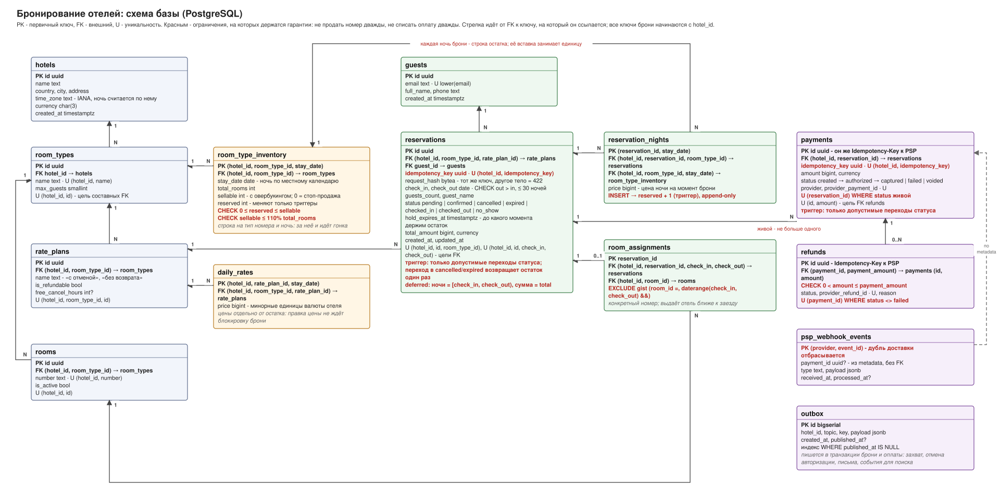

# Бронирование отелей: база данных

Неделя 1 задачи 2.2 из [`tasks/08`](<../../../tasks/08 - Microservices.md>): спроектировать базу бронирования отелей. Здесь только база; архитектура целиком (сервисы, брокер, C4) — неделя 2, в этом же каталоге.

Что лежит в каталоге:

| Файл                             | Что это                                                                                                                                                                         |
| -------------------------------- | ------------------------------------------------------------------------------------------------------------------------------------------------------------------------------- |
| [`schema.sql`](schema.sql)       | схема целиком: таблицы, ключи, `CHECK`, `EXCLUDE`, триггеры. Источник правды для диаграмм                                                                                       |
| [`verify.sh`](verify.sh)         | применяет схему к одноразовой базе `hotel_design` в Postgres из Compose и проверяет утверждения этого README: гонки, повторы, холды, оплаты. Базы `app` и `app_test` не трогает |
| [`er.drawio.svg`](er.drawio.svg) | ER-диаграмма                                                                                                                                                                    |

Все `.drawio.svg` — картинка и исходник в одном файле, открываются и правятся в draw.io.

```bash
docker compose up -d postgres
bash docs/system-design/hotel-reservation/verify.sh   # ~25 с, в конце ALL CHECKS PASSED
```

## Что проектируем

Уточняющие вопросы к бизнесу и ответы, которые я принял как допущения:

| Вопрос                                  | Допущение                                                                                                                                                                        |
| --------------------------------------- | -------------------------------------------------------------------------------------------------------------------------------------------------------------------------------- |
| Что продаём: конкретный номер или тип?  | **тип номера на даты** («Стандарт, 2–5 января»). Конкретный номер отель выдаёт ближе к заезду. Так работает отрасль: продавать номер 304 жёстко — невыгодно, мешает переселениям |
| Что такое «дата брони»                  | ночи: заезд включительно, выезд исключительно. Ночь — дата по **местному календарю отеля**                                                                                       |
| Насколько вперёд продаём                | 2 года (730 ночей), до 30 ночей в одной брони                                                                                                                                    |
| Овербукинг                              | разрешён по решению отеля, до 10% сверх числа номеров                                                                                                                            |
| Цены                                    | своя на каждую ночь и тариф («с бесплатной отменой», «без возврата»), в валюте отеля                                                                                             |
| Оплата                                  | картой через внешний платёжный провайдер (PSP): сначала авторизация (деньги заморожены), потом списание. «Оплата в отеле» — та же бронь без платежа                              |
| Сколько держим номер, пока гость платит | 15 минут (холд), потом остаток возвращается в продажу                                                                                                                            |
| Отмена                                  | по правилам тарифа; возврат одной операцией, за вычетом штрафа                                                                                                                   |
| Вне рамок недели                        | поиск по городу и датам (отдельный индекс, неделя 2), отзывы, лояльность, **channel manager** — синхронизация остатка с другими площадками, где отель продаёт те же номера       |

## Оценка нагрузки

Все цифры — допущения. Базовый сценарий — из главы Hotel Reservation у Алекса Сюя: 5 000 отелей, 1 млн номеров. Для сравнения порядка: Booking Holdings за 2023 год продала около 1,1 млрд ночей, то есть ~3 млн в сутки — это примерно ×4 от нашего сценария.

| Величина                      | Допущение или расчёт                                                                           | Итог                            |
| ----------------------------- | ---------------------------------------------------------------------------------------------- | ------------------------------- |
| Отели, номера                 | 5 000 отелей, в среднем 200 номеров, 20 типов номеров на отель (с запасом)                     | 1 млн номеров, 100 000 типов    |
| Проданные ночи в сутки        | 1 млн × загрузка 70%                                                                           | 700 000                         |
| Брони в сутки                 | 700 000 ÷ 3 ночи в среднем                                                                     | **≈ 233 000**, 2,7 в секунду    |
| Холды в сутки                 | до оплаты доходят 70% холдов                                                                   | ≈ 333 000                       |
| Транзакций брони в пике       | 333 000 ÷ 86 400 ≈ 3,9 в секунду, пик ×10 (распродажи, утро понедельника)                      | **≈ 40 в секунду**              |
| Все пишущие транзакции в пике | бронь 40 + платёж 40 + вебхуки PSP ~100 + отмены и истечения ~20                               | **≈ 200 в секунду**             |
| Чтения страницы отеля и брони | воронка ×10 на шаг: 3 брони → 30 открытий оплаты → 300 карточек в секунду; пик ×10             | 3 000 в секунду — кэш и реплики |
| Строк остатка                 | 100 000 типов × 730 ночей                                                                      | **73 млн**                      |
| Объём остатка                 | строка ~76 Б + запись первичного ключа ~75 Б                                                   | **≈ 11 ГБ**                     |
| Объём цен                     | 2 тарифа на тип: 146 млн строк × ~160 Б                                                        | ≈ 23 ГБ                         |
| Брони в год                   | 333 000 × 365 (истёкшие холды тоже строки) × ~525 Б со всеми индексами                         | 122 млн, **≈ 64 ГБ в год**      |
| Ночи броней в год             | 122 млн × 3 × ~135 Б                                                                           | ≈ 50 ГБ в год                   |
| Оплаты и возвраты в год       | 85 млн × ~400 Б                                                                                | ≈ 34 ГБ в год                   |
| Вебхуки PSP                   | ~3 события на оплату × ~1 КБ тела; храним 90 дней (окно повторов PSP с запасом), потом удаляем | ≈ 60 ГБ постоянно               |
| Рабочий набор                 | будущий остаток и цены (~34 ГБ) + брони ближайших месяцев                                      | влезает в 64–128 ГБ памяти      |

**Вывод для базы:** записи мало — ~200 транзакций в секунду по ~10 строк, это ~2 000 строк в секунду, один PostgreSQL на 8–16 vCPU держит на порядок больше. Объём — ~150–200 ГБ в год, тоже одна машина. Главное в этой задаче — не пропускная способность, а **корректность**: двойная продажа и двойное списание. Нагрузка на чтение (поиск и карточки) уходит в кэш, реплики и поисковый индекс — это неделя 2. Когда всё-таки шардировать — в разделе [«Шардирование»](#шардирование).

## Сущности, таблицы и связи



Четыре группы таблиц:

| Группа         | Таблицы                                                            | Кто пишет                                                   |
| -------------- | ------------------------------------------------------------------ | ----------------------------------------------------------- |
| каталог отеля  | `hotels`, `room_types`, `rooms`, `rate_plans`                      | отель через экстранет; редко                                |
| остаток и цены | `room_type_inventory`, `daily_rates`                               | остаток — триггеры брони; цены — отель или revenue-менеджер |
| бронь          | `guests`, `reservations`, `reservation_nights`, `room_assignments` | сервис брони; номер — ресепшн                               |
| оплата         | `payments`, `refunds`, `psp_webhook_events`, `outbox`              | сервис оплаты, обработчик вебхуков, релей                   |

Связи: отель 1:N типы номеров 1:N физические номера; тип 1:N тарифы 1:N цены по ночам; тип 1:N строки остатка (по одной на ночь). Бронь N:1 тариф и N:1 гость; бронь 1:N ночи, и каждая ночь N:1 строка остатка; бронь 1:0..1 выданный номер. Бронь 1:N оплат (живая — не больше одной), оплата 1:N возвратов (живой — не больше одного).

### Решения и их цена

| Решение                                                                                                                              | Почему                                                                                                                                                                                                              | Платим                                                                                                                                                              |
| ------------------------------------------------------------------------------------------------------------------------------------ | ------------------------------------------------------------------------------------------------------------------------------------------------------------------------------------------------------------------- | ------------------------------------------------------------------------------------------------------------------------------------------------------------------- |
| **Остаток — строка-счётчик на тип номера и ночь** (`room_type_inventory`: `sellable`, `reserved`)                                    | доступность — одно чтение по первичному ключу, а не подсчёт пересекающихся броней; у гонки появляется **конкретная строка**, которую можно заблокировать и на которую можно повесить `CHECK (reserved <= sellable)` | 73 млн строк, которые надо заранее создать на 2 года вперёд (ночная задача «докатить окно»); счётчик может разойтись с бронями — поэтому его меняют только триггеры |
| Счётчик меняют **только триггеры**: вставка ночи брони `+1`, переход брони в `cancelled`/`expired` `−1`                              | нельзя добавить ночь, не заняв остаток: забытый в коде `UPDATE` не приведёт к перепродаже. Тот же приём, что баланс кошелька в маркетплейсе ([docs/db](../../db/README.md))                                         | логика в базе, её не видно из кода сервиса; тесты на схему обязательны (`verify.sh`)                                                                                |
| **Ночи брони отдельной таблицей** (`reservation_nights`)                                                                             | цена фиксируется на момент брони (тариф потом меняется — бронь нет); отмена освобождает ровно те строки остатка, которые заняла; FK на остаток не даёт забронировать ночь, которой нет в продаже                    | ×3 строк к броням (~50 ГБ в год)                                                                                                                                    |
| Отложенная проверка при `COMMIT`: ночи покрывают ровно `[check_in, check_out)`, сумма = `total_amount`                               | бронь не может разойтись со своими ночами ни в датах, ни в деньгах                                                                                                                                                  | агрегат по ночам при каждой вставке брони (3 строки по первичному ключу — дёшево)                                                                                   |
| **Цены отдельно от остатка** (`daily_rates`)                                                                                         | разные писатели и частота: revenue-менеджер массово правит цены, бронь держит блокировку на строке остатка. В одной строке массовая правка цен ждала бы брони и наоборот                                            | лишнее соединение при расчёте цены                                                                                                                                  |
| **Конкретный номер — отдельно** (`room_assignments`) с `EXCLUDE USING gist (room_id WITH =, daterange(check_in, check_out) WITH &&)` | «не выдать один номер двум гостям на пересекающиеся даты» — правило над набором строк; `UNIQUE` его не выражает, проверка в коде гоняется. `EXCLUDE` делает это гарантией базы                                      | GiST-индекс и расширение `btree_gist`                                                                                                                               |
| **Ночь — `date` по местному календарю отеля**, а не `timestamptz`                                                                    | ночь 31 декабря в Бишкеке — календарная сущность, а не момент времени; с `timestamptz` ночь «съезжала» бы при смене зоны сервера. Моменты (`created_at`, `hold_expires_at`) — `timestamptz`, как в маркетплейсе     | при расчёте «бесплатная отмена до 14:00 дня заезда» нужен `hotels.time_zone`                                                                                        |
| **`hotel_id` в каждом ключе брони**, составные FK `(hotel_id, ...)`                                                                  | база гарантирует, что тип номера, тариф, номер и бронь принадлежат одному отелю; все ограничения брони локальны для отеля, поэтому шардирование по `hotel_id` потом не ломает ни одно из них                        | шире индексы; у `reservations` три лишних `UNIQUE` только как цели FK (~150 Б на строку, ~18 ГБ в год)                                                              |
| Деньги — `bigint` в минорных единицах, валюта — у отеля                                                                              | точно, как в маркетплейсе; цены отеля в одной валюте                                                                                                                                                                | конвертация для гостя в другой валюте — на витрине, в базе её нет                                                                                                   |
| Статусы — `enum` и триггер с таблицей допустимых переходов                                                                           | `expired → confirmed` или `captured → authorized` невозможны ни из какого кода; повторная обработка события — `UPDATE ... WHERE status = 'pending'`, 0 строк = уже сделано                                          | новый статус — миграция                                                                                                                                             |
| История статусов в базе **не** хранится, только текущий статус; переходы уходят событиями через `outbox`                             | истории ради споров и аналитики хватает в хранилище событий                                                                                                                                                         | расследование «кто отменил» — не SQL-запросом к основной базе                                                                                                       |
| Гость (`guests`) — единственная связь поперёк отелей                                                                                 | аккаунт один на все отели                                                                                                                                                                                           | при шардировании FK `guest_id` придётся убрать (см. ниже)                                                                                                           |
